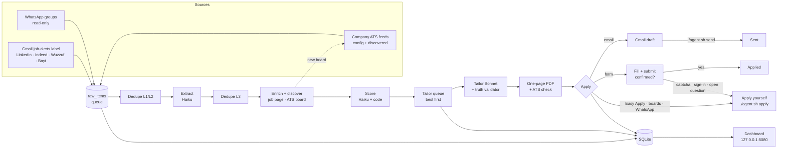

# job-agent

A daily job-application agent for one person, run from the command line. It reads job posts from **WhatsApp groups**, **job-alert emails** (LinkedIn, Indeed, Wuzzuf, Bayt) and **company job boards**, scores each job against a fact-checked profile, and writes a **one-page CV** and a **cover letter** for every good match. Then it applies: it **drafts the email**, **submits the web form**, or hands over a pre-filled form for one click. Built with **TypeScript on Node 22**, **SQLite**, **headless Claude Code** (`claude -p` on a Pro subscription), **Puppeteer**, **whatsapp-web.js**, the **Gmail API** and **Fastify**.

---

## Table of Contents

1. [Overview](#1-overview)
2. [Quick Start](#2-quick-start)
3. [Architecture](#3-architecture)
4. [Prerequisites](#4-prerequisites)
5. [Collection: WhatsApp, alerts, company boards](#5-collection-whatsapp-alerts-company-boards)
6. [Understanding a job: dedupe, extract, enrich, discover](#6-understanding-a-job-dedupe-extract-enrich-discover)
7. [Scoring](#7-scoring)
8. [The CV and the cover letter](#8-the-cv-and-the-cover-letter)
9. [Applying](#9-applying)
10. [Tracker dashboard](#10-tracker-dashboard)
11. [Security](#11-security)
12. [System Verification & End-to-End Testing](#12-system-verification--end-to-end-testing)
13. [Teardown](#13-teardown)
14. [Real-World Troubleshooting & Solutions](#14-real-world-troubleshooting--solutions)

---

## 1. Overview

| Component            | What it does                                                                                                                                                                | Where                                                   |
| -------------------- | --------------------------------------------------------------------------------------------------------------------------------------------------------------------------- | ------------------------------------------------------- |
| Collectors           | Read new posts since the last run: allowlisted WhatsApp groups (read-only), Gmail's `job-alerts` label, ATS job feeds (Greenhouse, Lever, Ashby, SmartRecruiters, Workable) | `src/collect/`                                          |
| Dedupe               | Five layers, from "same message" to "same job reposted elsewhere" to "already applied"                                                                                      | `src/pipeline/dedupe.ts`, `src/apply/guard.ts`          |
| Extract              | Claude Haiku turns a post (or a 20-job alert email) into structured jobs; emails and links must be copied literally                                                         | `src/pipeline/extract.ts`                               |
| Enrich and discover  | Follows the job link to the full description and to the company's own ATS posting; companies found this way are polled from then on                                         | `src/pipeline/enrich.ts`, `src/collect/ats/discover.ts` |
| Score                | Skills fit (Haiku, evidence must cite profile ids) and experience level (code)                                                                                              | `src/pipeline/score.ts`                                 |
| Tailor               | Claude Sonnet picks and rewrites only true profile content; a validator rejects any number, tool or claim not in the profile                                                | `src/tailor/`                                           |
| Render and ATS check | HTML → PDF that is exactly one page; then the PDF is parsed the way an ATS does and must pass                                                                               | `src/render/`                                           |
| Apply                | Gmail drafts (you send them all with one command), web forms submitted when confirmed, everything else pre-filled for one click                                             | `src/apply/`                                            |
| Orchestrator         | One run record around every stage; stops cleanly at the Claude usage limit and continues next time                                                                          | `src/run/orchestrator.ts`                               |
| Dashboard            | Tracker on 127.0.0.1: what to finish, drafts waiting, every job and its status                                                                                              | `src/dashboard/`, `dashboard/index.html`                |
| `agent.sh`           | The daily commands: `run`, `dashboard`, `apply`, `send`, `skipped` (and `retry`, `recheck`, `redo`, `dry-run`)                                                              | `agent.sh`                                              |

The decisions behind each part, with alternatives, are in [`docs/decisions.md`](docs/decisions.md) (D1–D36). The original spec is [`PLAN.md`](PLAN.md).

---

## 2. Quick Start

Full setup with every check: [`docs/runbooks/setup.md`](docs/runbooks/setup.md). Daily use: [`docs/runbooks/daily-use.md`](docs/runbooks/daily-use.md).

**1. Install and test.**

```bash
git clone https://github.com/ahmeddhussain/job-agent.git && cd job-agent
```

```bash
npm ci && npm test
```

**2. Create the private files** (`.env`, `config/config.yaml`, `profile/master_profile.yaml`) from their `.example` versions and fill in your own facts. [Details](docs/runbooks/setup.md#3-private-files-never-committed-gitignore-covers-them)

**3. Connect the accounts:** Claude (`claude setup-token` into `.env`), Gmail (`./agent.sh gmail-auth`, after [`docs/gmail-setup.md`](docs/gmail-setup.md)), WhatsApp (`./agent.sh whatsapp-login`). [Details](docs/runbooks/setup.md#4-claude-the-subscription-not-the-api)

**4. Run it.**

```bash
./agent.sh dry-run
```

```bash
./agent.sh run
```

**5. Finish and track.**

```bash
./agent.sh dashboard
```

```bash
./agent.sh send
```

```bash
./agent.sh apply
```

**Verify:** the run ends with `run N: SUCCESS`; the dashboard lists the jobs; Gmail → Drafts holds the email applications.

---

## 3. Architecture



- **One SQLite file** is the source of truth (`data/agent.db`, WAL mode, so the dashboard reads while a run writes).
- **Collection is decoupled from processing:** collectors store raw items and advance their watermarks; processing takes every item not yet processed. A run stopped by the usage limit, a crash or a failed source loses nothing (D31).
- **The model is a component, not the controller:** every Claude call returns JSON validated against a schema, runs with no tools, and its output is checked in code (literal emails and links, evidence ids, the truth validator, form options).

---

## 4. Prerequisites

| Tool / access        | Version                                  | Why                                                                      |
| -------------------- | ---------------------------------------- | ------------------------------------------------------------------------ |
| Linux with a desktop | RHEL 10 tested                           | The apply window and the dashboard open there                            |
| Node.js              | ≥ 22.12                                  | Runtime                                                                  |
| poppler-utils        | any                                      | Page count, text and font checks of each CV (ATS check)                  |
| Claude Code CLI      | pinned in `config.yaml` (2.1.317 tested) | Extraction, scoring, tailoring, form answers on the Pro/Max subscription |
| Google Cloud project | Gmail API, Desktop OAuth client          | Alerts in, drafts out                                                    |
| WhatsApp account     | a member of the job groups               | Read-only collection                                                     |

Exact npm versions are pinned in `package.json` and `package-lock.json`.

---

## 5. Collection: WhatsApp, alerts, company boards

**What and why.** Most of the jobs in this market are posted in WhatsApp groups and arrive as alert emails; company boards add roles that are never posted elsewhere. LinkedIn is read through its alert emails, not by scraping with a logged-in account (D4).

**How it's wired.**

- **WhatsApp** (D26): `whatsapp-web.js` behind a read-only facade (`getChats`, `fetchMessages`, `destroy` only; a test fails on any write call). Only allowlisted groups; text posts only; members are stored as salted hashes.
- **Alerts** (D27): Gmail label `job-alerts`; each email becomes one raw item with its links canonicalized. Click-trackers are decoded offline and personal tokens (Bayt `userToken`) stripped (troubleshooting #20).
- **Company boards** (D29, D30): public ATS feeds, pre-filtered by title, location and age before anything reaches the model. Boards come from `config/companies.yaml` **and from discovery**: a job link that leads to a company's ATS adds that board automatically.

**Commands.**

```bash
npm run agent -- collect whatsapp --dry-run
```

```bash
npm run agent -- collect alerts --dry-run
```

```bash
npm run agent -- companies
```

**Verify.** Each prints counts per group / email / board; `companies` lists config and discovered boards with how each was found.

---

## 6. Understanding a job: dedupe, extract, enrich, discover

**What and why.** The same job is forwarded across groups, reposted, and listed on LinkedIn and the company site. One application per job, and a full description before scoring.

**How it's wired.**

- **Dedupe:**
  - L0: same source id.
  - L1: same normalized text.
  - L2: simhash plus token similarity, for edited reposts.
  - L3: same company or apply target with a similar title, across sources.
  - L4: right before applying, the same address and role in the last 60 days, or an address you emailed by hand (Gmail Sent).
- **Extract:** Haiku splits multi-job posts and alerts. An email address, link or phone number is kept only if it appears literally in the post.
- **Enrich** (D30): LinkedIn's logged-out job page (description, company, offsite vs Easy Apply), schema.org `JobPosting` data on careers pages and Wuzzuf, or the ATS posting itself. Indeed and Bayt refuse automated requests and are never fetched.
- **Discover:** from a company name, the agent tries the likely board on five ATSs and keeps a board **only if it lists the same title**. Each name is probed at most every 14 days.

**Verify.** `./agent.sh run` prints `enriched "<title>" · <company>: company site https://…` for jobs it traced to the company's own posting.

---

## 7. Scoring

**What and why.** Apply widely to what fits, never to what doesn't.

**How it's wired** (D21):

- **Score:** 0.7 × skills fit (Haiku; every matched requirement must cite profile evidence) plus 0.3 × experience level in code (0 years = 100 … 3 years = 60).
- **Thresholds by title tier:** P1 target titles ≥ 45, P2 adjacent ≥ 60, P3 anything else ≥ 75.
- **Skipped without a model call:** excluded titles, more than 3 years required, outside Egypt and not remote, a passed deadline, or posted more than 30 days ago (D34: alerts also recommend old jobs).
- **Needs review:** scam patterns (fees, Telegram-only, "earn $X/day") and eligibility conditions.

**Commands.**

```bash
./agent.sh skipped 7
```

**Verify.** Every skipped job has a reason; `./agent.sh redo <id>` prepares one anyway.

---

## 8. The CV and the cover letter

**What and why.** Each application gets its own CV and letter, and must hold up in an interview: only true facts, one page, readable by an ATS.

**How it's wired.**

- **Tailor** (D24, D25): Sonnet selects and rewords bullets from `profile/master_profile.yaml` in the owner's own CV layout.
- **Validator:** any number, tool or certification that isn't in the source bullet or the profile fails the bullet (one retry, then the original text). Things in `not_held` can never appear.
- **Fit to one page** (D13, D23): font, then bullets, then projects, until the PDF is exactly one page.
- **ATS check** (D14): blocks the application unless the PDF has one page, text instead of images, embedded fonts, the required headings, contact links, and ≥ 70% of the job's backed keywords.
- **Cover letter** (D28): 180–250 words, facts only. It's the email body for email jobs and the paste-box text for forms.

**Commands.**

```bash
npm run agent -- tailor:fixtures --replay
```

**Verify.** `P3 GATE PASS: 3 tailored applications` (one page, ATS pass, 100% keywords on the fixtures).

---

## 9. Applying

**What and why.** The agent does the searching, the writing and the form filling. You review emails and click where a site requires a human (D33).

| Channel                                                                 | Agent                                                           | You                                                                          |
| ----------------------------------------------------------------------- | --------------------------------------------------------------- | ---------------------------------------------------------------------------- |
| Email                                                                   | Gmail **draft** (letter as body, CV attached, required subject) | Review, then `./agent.sh send` sends them all                                |
| Web form, no captcha                                                    | Fills, uploads the CV, **submits**, checks the confirmation     | Nothing                                                                      |
| Web form with captcha, sign-in, or a question your profile can't answer | Tries; if not confirmed → **Apply yourself**, with the reason   | `./agent.sh apply`: the form opens pre-filled; submit                        |
| LinkedIn Easy Apply, Wuzzuf, Bayt, Indeed                               | CV and letter ready → **Apply yourself**                        | `./agent.sh apply` opens the job (signed in as you), letter on the clipboard |
| WhatsApp                                                                | CV and letter, wa.me link                                       | Send from the phone                                                          |

The agent never solves or bypasses a captcha, never logs in to your accounts, never sends WhatsApp messages, and never sends email without your command.

**Verify.** The dashboard's **Apply yourself** and **Email drafts waiting** sections list what's left; `form.json` and the screenshots in each job's folder show what was filled.

---

## 10. Tracker dashboard

**What and why.** One page to see what's done and what's left.

**How it's wired** (D32, D36): Fastify on `127.0.0.1:8080` serves `dashboard/index.html` and a small JSON API.

- **Sections:** Today, Needs action, Applied (a drag-and-drop board), Skipped (by reason, with "Prepare anyway"), All jobs, Profile, Companies and Runs, plus a detail panel per job.
- **Profile edits:** the Profile section edits your ready answers, written to `profile/master_profile.yaml` with comments kept and a `.bak`. Form questions your profile can't answer are listed there to answer once (D35).
- **Status edits** are written to `status_history`.
- **Files** are served by job id only, from inside `output/`.

```bash
./agent.sh dashboard
```

**Verify.** The page loads with real jobs; a status change survives a reload.

---

## 11. Security

The full threat model, every control (A1–A20) and the host checklist (H1–H12) are in [`docs/security.md`](docs/security.md). In short:

- **Claude:** `claude -p --tools ""` in an empty folder, with an environment allowlist; the agent refuses to run if an API key would be used.
- **Job posts and web pages** are untrusted text, fenced in prompts, and every output is validated.
- **Fetching:** https only to public addresses, redirects re-checked, polite pacing.
- **Accounts:** Gmail with two scopes (read + compose), the digest to yourself only. WhatsApp read-only, by test. Forms in a fresh browser profile with private addresses blocked.
- **Dashboard:** loopback only, Host allowlist, JSON-only same-origin writes, strict CSP.
- **Git:** secrets and personal data never committed: `.gitignore` plus a pre-commit scan with a private blocklist.

---

## 12. System Verification & End-to-End Testing

```bash
npm run lint && npm run typecheck && npm test
```

**The suite covers:**

- every stage on fixtures: 28 real-style posts with recorded model outputs;
- real PDF rendering and the ATS check;
- the form filler on local pages: CV upload, a captcha fallback, an unanswerable required question that blocks the submit, a two-page form, private addresses blocked;
- the orchestrator end to end, including the usage-limit stop and resume;
- the dashboard API, including path traversal, DNS rebinding and cross-site writes;
- the WhatsApp read-only guard.

**Live checks (2026-11-22):**

| Check                                                    | Result                                                                                                                                                                                                                                                                                              |
| -------------------------------------------------------- | --------------------------------------------------------------------------------------------------------------------------------------------------------------------------------------------------------------------------------------------------------------------------------------------------- |
| Dry run on 12 stored posts                               | 11 jobs scored; 2 applications prepared (one-page CVs, ATS pass, 100% keywords); 20 model calls, 0 failures                                                                                                                                                                                         |
| Discovery on real alert jobs                             | A Thndr LinkedIn alert was traced to its Ashby board and direct application form; Henkel (Workday) got the description only; a Wuzzuf job got description, company and deadline                                                                                                                     |
| Form filler on Thndr's real Ashby form (fill only)       | CV uploaded, 7 fields filled truthfully; stopped at "Current Salary" (not in the profile) instead of guessing                                                                                                                                                                                       |
| Live run 1: WhatsApp group + one week of alerts (49 min) | 54 items → 162 jobs → 25 prepared (1 Gmail draft, 24 "Apply yourself"), 19 to review, 118 skipped with reasons; 72 jobs enriched; 4 company boards discovered; 216 Claude calls, 0 failed; 0 forms submitted (no ready job had a company form that week). Details: `docs/decisions.md` D33 addendum |

---

## 13. Teardown

| What                                 | How                                                                                                |
| ------------------------------------ | -------------------------------------------------------------------------------------------------- |
| Stop the agent                       | Nothing runs in the background; `./agent.sh dashboard` stops with Ctrl-C                           |
| Gmail access                         | https://myaccount.google.com/permissions → remove the app; delete `secrets/gmail_token.json`       |
| WhatsApp                             | Phone → Linked devices → log out the agent; delete `data/wa-session`                               |
| LinkedIn sign-in of the apply window | Delete `data/browser-profile`                                                                      |
| Claude token                         | Revoke in the Claude account; remove from `.env`                                                   |
| All personal data                    | Delete `data/`, `output/`, `secrets/`, `.env`, `config/config.yaml`, `profile/master_profile.yaml` |

---

## 14. Real-World Troubleshooting & Solutions

Every issue met while building this, with the exact error, is in [`docs/troubleshooting.md`](docs/troubleshooting.md) (#1–#29). A selection:

**WhatsApp hung after scanning the QR, and a second command was refused (#14).**

- _Symptom:_ no output after the scan; `wa:groups` in another terminal failed.
- _Diagnosis:_ two processes shared one Chrome profile; an unhandled rejection kept the first alive.
- _Fix:_ a pid lock per WhatsApp command, a handled rejection, and progress output.

**The VM clock was 18 hours slow (#15).**

- _Symptom:_ WhatsApp "new" messages from the future; OAuth and TLS oddities.
- _Diagnosis:_ chrony was not stepping the clock.
- _Fix:_ `makestep 1.0 -1` in chrony, plus a clock-skew guard in the collector.

**Real alert links carried a personal login token (#20).**

- _Symptom:_ every Bayt link had `userToken=…`; Wuzzuf links were `awstrack.me` trackers.
- _Diagnosis:_ the canonicalizer kept unknown parameters.
- _Fix:_ trackers decoded offline, personal tokens stripped before storing, tests with the real link shapes.

**LinkedIn's public page no longer shows the company's apply link (#21).**

- _Symptom:_ no `applyUrl` on 4 real job pages.
- _Diagnosis:_ LinkedIn shows it only after sign-in.
- _Fix:_ the agent finds the company's ATS board from the name and accepts it only on a same-title match.

**Guessing a board took a minute per company (#23).**

- _Symptom:_ 59 s for one job.
- _Diagnosis:_ Lever answers an unknown board's 404 after about 24 s.
- _Fix:_ probes with an 8 s timeout and no retries, the five ATSs asked in parallel: 8 s.

**A page that never confirmed counted as submitted (#26).**

- _Symptom:_ a captcha test page was reported as submitted.
- _Diagnosis:_ a URL containing "submitted" counted as success even though it hadn't changed.
- _Fix:_ only a URL that changed after the click counts; confirmation text is the main signal.

**Known gaps (honest list):**

- Captcha-protected ATS forms (Greenhouse, Lever, Ashby) usually end in "Apply yourself".
- Workday and SuccessFactors boards (large employers) aren't supported.
- Workable's job feed fields were not verified on a live board with openings.
- The Gmail app in Testing mode needs re-authorizing every 7 days.
- Image-only job flyers are out of scope.
