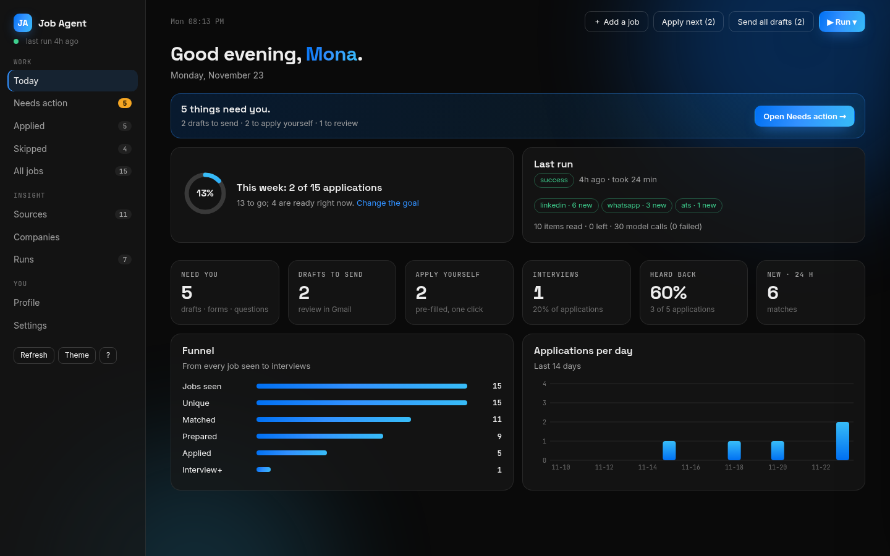
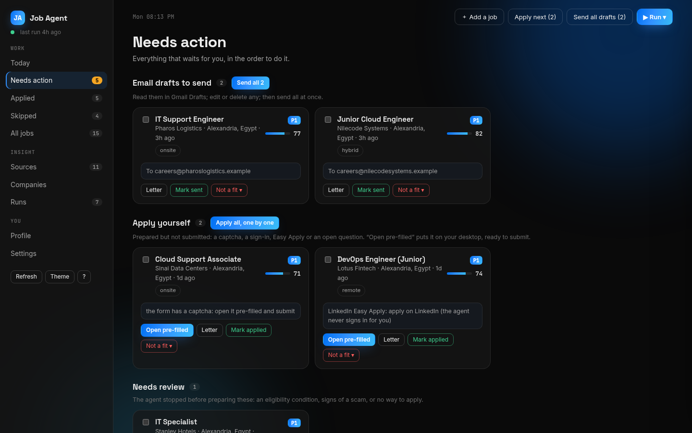
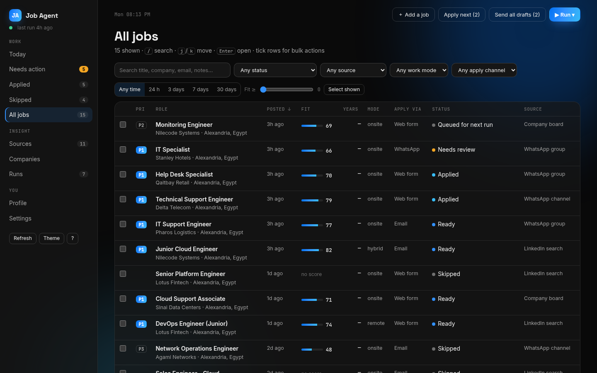
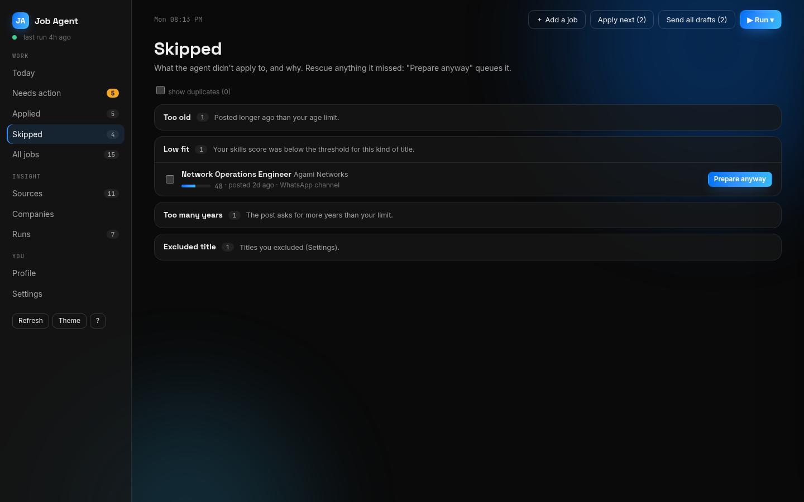
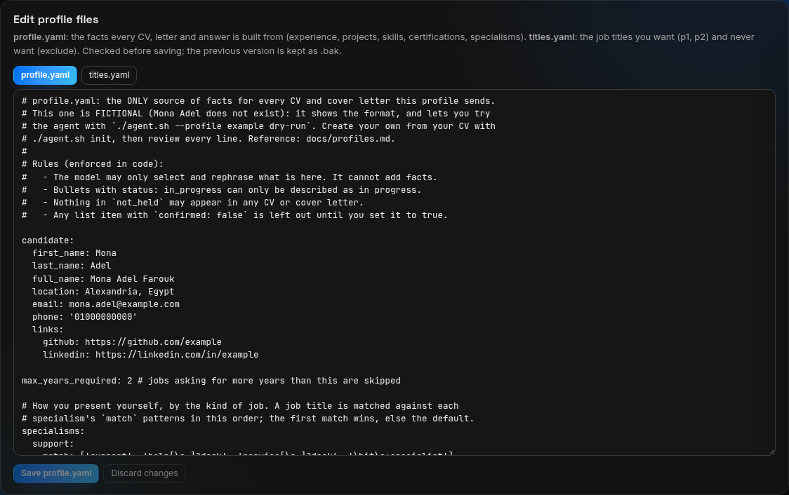
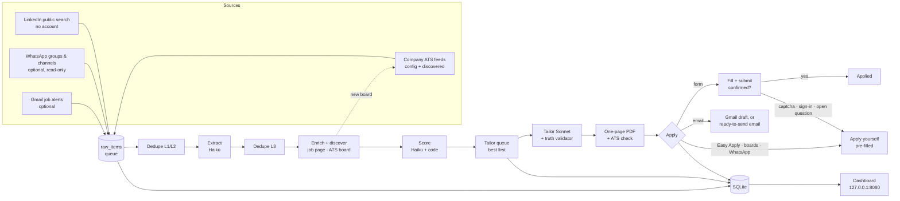

# job-agent

Your own job-application agent, on your own machine. It finds jobs (**LinkedIn search**, **company job boards**, and optionally **WhatsApp groups** and **job-alert emails**), scores each one against your profile, and writes a **one-page CV** and a **cover letter** for every good match, using only facts you gave it. Then it applies: it **submits web forms**, **drafts emails** for you to review, and hands you the rest pre-filled for one click.

All it needs is a **Claude subscription** (Pro or Max). Built with **TypeScript on Node 22**, **SQLite**, **headless Claude Code** (`claude -p`), **Puppeteer**, **Fastify**, and optionally **whatsapp-web.js** and the **Gmail API**.



---

## Table of Contents

1. [Overview](#1-overview)
2. [Quick Start](#2-quick-start)
3. [Documentation](#3-documentation)
4. [Architecture](#4-architecture)
5. [Prerequisites](#5-prerequisites)
6. [Profiles and configuration](#6-profiles-and-configuration)
7. [Sources](#7-sources)
8. [Scoring](#8-scoring)
9. [The CV and the cover letter](#9-the-cv-and-the-cover-letter)
10. [Applying](#10-applying)
11. [Dashboard](#11-dashboard)
12. [Privacy and security](#12-privacy-and-security)
13. [System Verification & End-to-End Testing](#13-system-verification--end-to-end-testing)
14. [Teardown](#14-teardown)
15. [Real-World Troubleshooting & Solutions](#15-real-world-troubleshooting--solutions)
16. [Contributing and license](#16-contributing-and-license)

---

## 1. Overview

**What a day looks like:** `./agent.sh run` in the morning. Then the dashboard shows:

- what it already submitted;
- the email drafts waiting for your review;
- a short list of jobs to finish yourself, each one pre-filled.

| Component                 | What it does                                                                                                                                                                                                 | Where                                          |
| ------------------------- | ------------------------------------------------------------------------------------------------------------------------------------------------------------------------------------------------------------ | ---------------------------------------------- |
| Profiles                  | One private folder per person: settings, facts, job titles, data. Created from your CV by `./agent.sh init`                                                                                                  | `profiles/<name>/`, `config/defaults.yaml`     |
| Collectors                | New jobs since the last run: LinkedIn's public search, company ATS feeds (Greenhouse, Lever, Ashby, SmartRecruiters, Workable), and optionally WhatsApp groups and channels (read-only) and Gmail job alerts | `src/collect/`                                 |
| Dedupe                    | Five layers, from "same message" to "same job reposted elsewhere" to "already applied"                                                                                                                       | `src/pipeline/dedupe.ts`, `src/apply/guard.ts` |
| Extract, enrich, discover | Claude Haiku turns posts into structured jobs. The agent follows links to the full description and the company's own posting; companies found this way are polled from then on                               | `src/pipeline/`, `src/collect/ats/discover.ts` |
| Score                     | Skills fit (every match must cite your profile) and experience (in code), against your title tiers                                                                                                           | `src/pipeline/score.ts`                        |
| Tailor                    | Claude Sonnet picks and rewrites only your true facts; a validator rejects any number, tool or claim not in your profile                                                                                     | `src/tailor/`                                  |
| Render and ATS check      | A PDF of exactly one page, then parsed the way an applicant tracking system reads it                                                                                                                         | `src/render/`                                  |
| Apply                     | Web forms submitted when confirmed, Gmail drafts (or ready-to-send emails without Gmail), everything else pre-filled                                                                                         | `src/apply/`                                   |
| Dashboard                 | A local tracker: what to do, what was sent, every job and why; settings and a profile editor                                                                                                                 | `src/dashboard/`, `dashboard/index.html`       |
| `install.sh`, `agent.sh`  | Setup checks, and every command you need                                                                                                                                                                     | repo root                                      |

|                                                                                                          |                                                                                                              |
| -------------------------------------------------------------------------------------------------------- | ------------------------------------------------------------------------------------------------------------ |
|  |                              |
|                    |  |

_Screenshots use the fictional example profile and demo data (`./agent.sh demo`)._

---

## 2. Quick Start

The full walkthrough, with a check after every step, is [`docs/getting-started.md`](docs/getting-started.md).

**1. Install.** Node 22.12+, poppler and [Claude Code](https://docs.anthropic.com/en/docs/claude-code) signed in with your subscription; `install.sh` checks them and says what is missing.

```bash
git clone https://github.com/ahmeddhussain/job-agent.git && cd job-agent
```

```bash
./install.sh
```

**2. Try the demo (optional).** Fictional jobs in the example profile, no account used:

```bash
./agent.sh demo && ./agent.sh --profile example dashboard
```

**3. Create your profile from your CV.** Claude drafts your facts, job titles and search titles. [Details](docs/getting-started.md#3-create-your-profile)

```bash
./agent.sh init
```

**4. Review it**, in `profiles/<name>/` or the dashboard (Profile → Edit profile files). Every CV is built only from these facts. [Details](docs/getting-started.md#4-review-it-required)

```bash
./agent.sh reviewed
```

**5. Run it.** First on a copy of the database (nothing is sent), then for real:

```bash
./agent.sh dry-run
```

```bash
./agent.sh run
```

**6. Finish and track.**

```bash
./agent.sh dashboard
```

```bash
./agent.sh apply
```

**Verify:** the run prints `preflight: claude …, apiKeySource=none (subscription)` and ends with `run N: SUCCESS`; the dashboard lists the jobs, with what's left under **Needs action**.

---

## 3. Documentation

| Guide                                            | What's in it                                                                                            |
| ------------------------------------------------ | ------------------------------------------------------------------------------------------------------- |
| [Getting started](docs/getting-started.md)       | Install, create and review your profile, first runs                                                     |
| [Daily use](docs/daily-use.md)                   | The 10-minute routine, every command, what to do when something looks wrong                             |
| [Profiles](docs/profiles.md)                     | `profile.yaml` (facts, specialisms, skills with evidence), `titles.yaml`, several people on one machine |
| [Configuration](docs/configuration.md)           | Defaults and your overrides, the settings you're likely to change, choosing a profile                   |
| [Sources](docs/sources.md)                       | LinkedIn search, company boards, WhatsApp, job-alert emails, adding a post by hand                      |
| [Gmail setup](docs/gmail-setup.md)               | Optional: drafts, alerts and the digest through your own Google Cloud app                               |
| [Privacy and security](docs/privacy-security.md) | What stays local, what is sent where, what the agent never does, removing access                        |
| [FAQ](docs/faq.md)                               | Costs, auto-applying, truthfulness, other fields and countries, troubleshooting                         |
| [Developer docs](docs/dev/)                      | The original spec, decisions D1–D45, the threat model, the troubleshooting log, audits                  |

---

## 4. Architecture



- **One profile folder per person** holds everything that is theirs. The CLI runs inside it, so every path means "in this profile" (D45).
- **One SQLite file** per profile is the source of truth (WAL mode, so the dashboard reads while a run writes).
- **Collection is decoupled from processing:** collectors store raw items and advance their watermarks; processing takes every item not yet processed. A run stopped by the usage limit, a crash or a failed source loses nothing (D31).
- **The model is a component, not the controller:** every Claude call returns JSON validated against a schema, runs with no tools, and its output is checked in code (literal emails and links, evidence ids, the truth validator, form options).

---

## 5. Prerequisites

| Tool / access        | Version                                         | Why                                                                             |
| -------------------- | ----------------------------------------------- | ------------------------------------------------------------------------------- |
| Linux with a desktop | RHEL 10 and Ubuntu 24.04 tested; macOS untested | The apply window and the dashboard open there                                   |
| Node.js              | ≥ 22.12                                         | Runtime                                                                         |
| poppler-utils        | any                                             | Page count, text and font checks of each CV                                     |
| Claude Code CLI      | 2.1.317 tested (`llm.cli.pinned_version`)       | Reading, scoring, writing, form answers, on your Claude Pro or Max subscription |
| Google Cloud project | optional: Gmail API, Desktop OAuth client       | Email drafts, job alerts, digest                                                |
| WhatsApp account     | optional: a member of job groups                | Read-only collection                                                            |

Exact npm versions are pinned in `package.json` and `package-lock.json`.

---

## 6. Profiles and configuration

**What and why.** Nothing about one person is in the code: not the job titles, not how they present themselves, not their location. Each person gets a folder, and the shipped defaults cover the rest (D44, D45).

**How it's wired.**

- `profiles/<name>/config.yaml` holds only the settings you change. It is merged over `config/defaults.yaml` and validated as a whole (a typo names the key).
- `profile.yaml` holds your facts:
  - experience, projects, skills (each linked to evidence), certifications, things you must never claim;
  - **specialisms**: how you present yourself per kind of job ("IT Support Engineer" for support titles, "Junior Cloud Engineer" for cloud titles), each with its own headline, summary, pitch and projects.
- `titles.yaml` holds your title tiers: `p1` wanted most, `p2` adjacent, `exclude` never.
- `./agent.sh init` drafts all three from your CV with one Claude call. Runs refuse the profile until you review it.
- Several people can share an installation (`--profile <name>`, `./agent.sh use <name>`).

**Commands.**

```bash
./agent.sh profiles
```

```bash
./agent.sh status
```

**Verify.** `status` prints `config OK … (merged over config/defaults.yaml)`, the profile name and which sources are on.

---

## 7. Sources

**What and why.** Jobs are where people post them: LinkedIn, companies' own boards, and in some markets mostly WhatsApp groups and channels. Wuzzuf, Indeed and Bayt arrive only as alert emails (their sites refuse automated search).

**How it's wired.**

- **LinkedIn search** (D38): the public job search, logged out, for each of your titles, only for jobs posted since that title's last search. Refused pages are retried and finished next run.
- **Company boards** (D29, D30): public ATS feeds, filtered by title, location and age. They come from `companies.yaml` **and from discovery**: a job link that leads to a company's ATS adds that board.
- **WhatsApp** (D26, D37), optional: allowlisted groups and every channel you follow, behind a read-only facade (a test fails on any write call); text only; members stored as salted hashes.
- **Alerts** (D27), optional: the Gmail label `job-alerts`. Click-trackers are decoded offline and personal tokens stripped.

**Commands.**

```bash
npm run agent -- collect linkedin --dry-run
```

```bash
npm run agent -- companies
```

**Verify.** Counts per search title and per board; `companies` shows how each board was found. All sources: [`docs/sources.md`](docs/sources.md).

---

## 8. Scoring

**What and why.** Apply widely to what fits, never to what doesn't.

**How it's wired** (D21, D42):

- **Score:** 0.7 × skills fit (Haiku; every matched requirement must cite profile evidence) plus 0.3 × experience level in code (0 years = 100 … 3 years = 60).
- **Thresholds by title tier:** P1 ≥ 45, P2 ≥ 60, anything else ≥ 75 (all configurable).
- **Skipped without a model call:**
  - excluded titles;
  - more years than you can match;
  - outside your countries and not remote;
  - a passed deadline, or a posting older than 30 days.
- **Needs review:** scam patterns (fees, Telegram-only, "earn $X/day") and eligibility conditions.
- **Learning:** "Not a fit" reasons suggest rules (exclude a title, block a company, a threshold); you accept or dismiss each one.

**Commands.**

```bash
./agent.sh skipped 7
```

**Verify.** Every skipped job has a reason; "Prepare anyway" or `./agent.sh redo <id>` prepares one regardless.

---

## 9. The CV and the cover letter

**What and why.** Each application gets its own CV and letter. They must hold up in an interview: only true facts, one page, readable by an ATS.

**How it's wired.**

- **Tailor** (D24, D25, D44): Sonnet picks the specialism for the job title, then selects and rewords your bullets.
- **Validator:** any number, tool or certification that isn't in the source bullet or the profile fails the bullet (one retry, then the original text). Things in `not_held` can never appear.
- **Fit to one page** (D13, D23): font, then bullets, then projects, until the PDF is exactly one page.
- **ATS check** (D14): blocks the application unless the PDF has:
  - one page, text instead of images, and embedded fonts;
  - the required headings and the contact links;
  - at least 70% of the job's requirements that your profile backs.
- **Cover letter** (D28): short, facts only. It is the email body for email jobs and the paste-box text for forms.

**Commands.**

```bash
npm run agent -- tailor:fixtures --replay
```

**Verify.** `P3 GATE PASS: 3 tailored applications` (one page, ATS pass, 100% keywords on the fixtures).

---

## 10. Applying

**What and why.** The agent does the searching, the writing and the form filling. You review emails and click where a site requires a human (D33).

| Channel                                                                     | Agent                                                           | You                                                                          |
| --------------------------------------------------------------------------- | --------------------------------------------------------------- | ---------------------------------------------------------------------------- |
| Email, with Gmail                                                           | Gmail **draft** (letter as body, CV attached, required subject) | Review, then `./agent.sh send` sends them all                                |
| Email, without Gmail                                                        | The email written out, in **Apply yourself**                    | **Write the email** opens your mail app filled in; attach the CV             |
| Web form, no captcha                                                        | Fills, uploads the CV, **submits**, checks the confirmation     | Nothing                                                                      |
| Web form with a captcha, a sign-in, or a question your profile can't answer | Tries; if not confirmed → **Apply yourself**, with the reason   | `./agent.sh apply`: the form opens pre-filled; submit                        |
| LinkedIn Easy Apply, Wuzzuf, Bayt, Indeed                                   | CV and letter ready → **Apply yourself**                        | `./agent.sh apply` opens the job (signed in as you), letter on the clipboard |
| WhatsApp                                                                    | CV and letter, wa.me link                                       | Send from your phone                                                         |

The agent never solves or bypasses a captcha, never logs in to your accounts, never sends WhatsApp messages, and never sends email without your command.

**Verify.** The dashboard's **Needs action** lists what's left; `form.json` and the screenshots in each job's folder show what was filled.

---

## 11. Dashboard

**What and why.** One page to see what's done and what's left, and to change what the agent does.

**How it's wired** (D32, D36, D39–D43, D45): Fastify on `127.0.0.1:8080` serves `dashboard/index.html` and a small JSON API.

- **Pages:**
  - Today, Needs action, Applied (a drag-and-drop board), Skipped (by reason, with "Prepare anyway");
  - All jobs (filters, bulk actions), Sources (a scoreboard), Companies, Runs;
  - Profile, Settings, and a detail panel per job.
- **Actions:**
  - ▶ Run: run, queue only, dry run, retry forms, recheck dates;
  - Send all drafts, Apply next (pre-filled on your desktop), quick add;
  - "Not a fit" with reasons, favorite and blocked companies, follow-up drafts, interview prep, a CV preview.
- **Profile:** ready form answers, questions forms asked that your profile doesn't answer, and an editor for `profile.yaml` and `titles.yaml`. The editor validates exactly like a run, keeps a `.bak` and writes atomically.
- **Settings** are written back to your `config.yaml` and `titles.yaml`, comments kept.
- **Loads nothing from outside:** fonts are served locally.

```bash
./agent.sh dashboard
```

**Verify.** The page loads with your jobs; a status change survives a reload.

---

## 12. Privacy and security

What is stored, sent and never done: [`docs/privacy-security.md`](docs/privacy-security.md). The full threat model (A1–A25) and host checklist: [`docs/dev/security.md`](docs/dev/security.md). In short:

- **Claude:** `claude -p --tools ""` in an empty folder, with an environment allowlist. The agent refuses to run if an API key would be used, so your subscription is used, never API credits.
- **Untrusted input:** job posts and web pages are fenced in prompts, and every output is validated. Your email and phone are never in a prompt (they're added to the CV in code).
- **Fetching:** https only, to public addresses, redirects re-checked, polite pacing.
- **Accounts:**
  - Gmail with two scopes (read and compose), the digest to yourself only;
  - WhatsApp read-only, enforced by a test;
  - forms in a fresh browser profile, with private addresses blocked.
- **Dashboard:** loopback only, Host allowlist, JSON-only same-origin writes, strict CSP.
- **Git:** profile folders, backups and secrets are never committed: `.gitignore`, plus a pre-commit scan with a private blocklist.

---

## 13. System Verification & End-to-End Testing

```bash
npm run lint && npm run typecheck && npm test
```

**The suite (300+ tests, no accounts needed) covers:**

- every stage on fixtures: 28 real-style posts with recorded model outputs;
- real PDF rendering and the ATS check;
- the form filler on local pages: CV upload, captcha fallback, an unanswerable required question that blocks the submit, a two-page form, private addresses blocked;
- the orchestrator end to end, with and without Gmail, including the usage-limit stop and resume;
- profiles: selection, layered config, the profile editor's validation;
- the dashboard API, including path traversal, DNS rebinding and cross-site writes;
- the WhatsApp read-only guard and the secrets scan.

**Independent audit (2026-11-23):** a hand re-collection of WhatsApp, alerts and LinkedIn, compared with the database, found nothing missed; title tiers were widened from the evidence ([`docs/dev/audits/2026-11-23-final-test.md`](docs/dev/audits/2026-11-23-final-test.md)).

**Live checks (2026-11-22, the author's profile):**

| Check                                                    | Result                                                                                                                                               |
| -------------------------------------------------------- | ---------------------------------------------------------------------------------------------------------------------------------------------------- |
| Dry run on 12 stored posts                               | 11 jobs scored; 2 applications prepared (one-page CVs, ATS pass, 100% keywords); 20 model calls, 0 failures                                          |
| Discovery on real alert jobs                             | A LinkedIn alert traced to the company's Ashby board and direct application form; a Wuzzuf job got description, company and deadline                 |
| Form filler on a real Ashby form (fill only)             | CV uploaded, 7 fields filled truthfully; stopped at "Current Salary" (not in the profile) instead of guessing                                        |
| Live run: a WhatsApp group + one week of alerts (49 min) | 54 items → 162 jobs → 25 prepared, 19 to review, 118 skipped with reasons; 72 jobs enriched; 4 company boards discovered; 216 Claude calls, 0 failed |

---

## 14. Teardown

| What                           | How                                                                                                            |
| ------------------------------ | -------------------------------------------------------------------------------------------------------------- |
| Stop the agent                 | Nothing runs in the background; the dashboard stops with Ctrl-C                                                |
| Gmail access                   | <https://myaccount.google.com/permissions> → remove the app; delete `secrets/gmail_token.json` in your profile |
| WhatsApp                       | Phone → Linked devices → log out the agent; delete `data/wa-session` in your profile                           |
| The apply window's sign-ins    | Delete `data/browser-profile` in your profile                                                                  |
| Claude token (if you used one) | Revoke it in your Claude account; remove it from the profile's `.env`                                          |
| All personal data              | Delete `profiles/<name>/`                                                                                      |

---

## 15. Real-World Troubleshooting & Solutions

Common problems and fixes: [`docs/faq.md`](docs/faq.md#troubleshooting). Every issue met while building this, with the exact error: [`docs/dev/troubleshooting.md`](docs/dev/troubleshooting.md) (#1–#33). A selection:

**WhatsApp hung after scanning the QR, and a second command was refused (#14).**

- _Symptom:_ no output after the scan; `wa:groups` in another terminal failed.
- _Diagnosis:_ two processes shared one Chrome profile; an unhandled rejection kept the first alive.
- _Fix:_ a pid lock per WhatsApp command, a handled rejection, and progress output.

**Real alert links carried a personal login token (#20).**

- _Symptom:_ every Bayt link had `userToken=…`; Wuzzuf links were `awstrack.me` trackers.
- _Diagnosis:_ the canonicalizer kept unknown parameters.
- _Fix:_ trackers decoded offline, personal tokens stripped before storing, tests with the real link shapes.

**Guessing a company's board took a minute per company (#23).**

- _Symptom:_ 59 s for one job.
- _Diagnosis:_ Lever answers an unknown board's 404 after about 24 s.
- _Fix:_ probes with an 8 s timeout and no retries, the five ATSs asked in parallel: 8 s.

**A page that never confirmed counted as submitted (#26).**

- _Symptom:_ a captcha test page was reported as submitted.
- _Diagnosis:_ a URL containing "submitted" counted as success even though it hadn't changed.
- _Fix:_ only a URL that changed after the click counts; confirmation text is the main signal.

**A job queued with "Prepare anyway" kept returning to review (#32).**

- _Symptom:_ `ATS check failed: keyword coverage 50% < 70%`, missing `java`.
- _Diagnosis:_ "one or more of: … Java, SQL …" was counted term by term, on a sample of two.
- _Fix:_ alternatives count once, small samples allow one miss, and a job you queued yourself goes ahead on a keyword-only failure (flagged).

**Known gaps (honest list):**

- Captcha-protected ATS forms (Greenhouse, Lever, Ashby) usually end in "Apply yourself".
- Workday and SuccessFactors boards (large employers) aren't supported.
- CVs are written in English; the CV template's sections are fixed.
- macOS and Windows (WSL2) are untested.
- A Gmail app in Testing mode needs re-authorizing every 7 days.
- Image-only job flyers are out of scope.

---

## 16. Contributing and license

Contributions are welcome: [`CONTRIBUTING.md`](CONTRIBUTING.md). Released under the [MIT License](LICENSE).
